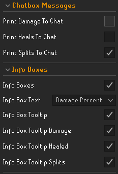
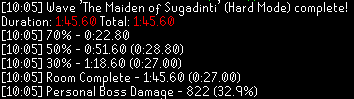
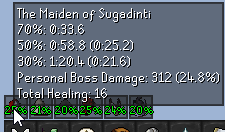

# Theatre of Blood Stats

A RuneLite plugin for tracking detailed Theatre of Blood performance statistics, including custom damage tracking and precise room split timings.

The plugin is designed for players who want deeper insight into their ToB runs by providing breakdowns of damage output and room phase times.

## Features

### Damage Tracking & Detailed Room Split Timings

Track your performance throughout a Theatre of Blood run with detailed damage statistics.
Automatically tracks timing splits for boss phases.

Useful for:

- Improving personal PBs
- Comparing raid performance
- Identifying areas for improvement
- Analysing team efficiency

### Customisable Display Options

Choose how your statistics are displayed:

### Config Options

#### Chat Messages

Display run information directly in the chat box.

#### Infobox Overlay

Display information using a customisable RuneLite infobox overlay.

.png)

.png)

## Installation

### RuneLite Plugin Hub

1. Open RuneLite
2. Navigate to the Plugin Hub
3. Search for **Theatre of Blood Stats**
4. Install and enable the plugin

## Configuration

The plugin provides configuration options to customise:

- Damage tracking behaviour
- Display format
- Chat output
- Infobox visibility
- Split information shown
- Overlay positioning

## Why Use This Plugin?

Theatre of Blood rewards consistency and optimisation. Standard raid completion times only show the final result, while detailed splits help identify exactly where time is gained or lost.

This plugin provides extra information to help with:

- Improved room execution
- Comparing runs
- Pushing for faster completion times

## Contributing

Contributions, bug reports, and feature suggestions are welcome.

If you find an issue, please open a GitHub issue with:

- A description of the problem
- Steps to reproduce it
- Relevant logs or screenshots

## Credits

Created by [HarrySJ96](https://github.com/HarrySJ96)

Built for the RuneLite community.

## License

See the repository license for details.